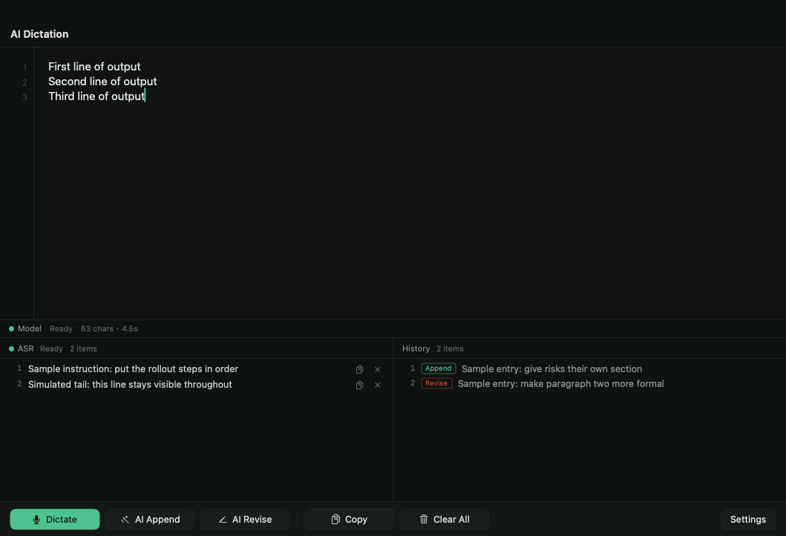

# Vox Dictation

[English](README.md) | 中文

一个 macOS 听写工具，不只是把语音转成文字——它会改稿。点 **ASR 录入** 说话，这段语音先成为一条**指令**；点 **AI整理** 把它并进你正在写的正文，点 **AI修改** 按它的要求改写已有内容。文字落在你的光标处，任何能粘贴的应用都能用。



## 和普通语音输入的区别

纯转写只会把你说的话原样码成一大段。但写字很少是这个状态：你会说"补一句回滚规则"，或者说"第二段语气改正式点"。Vox 把口述内容当成一列待发指令，只有你按下按钮时它才动你的稿子：

- **ASR 录入** — 点一下开始，再点一下停止。每说一次就是一条带编号的指令。
- **AI整理** — 把新增内容整理成和现有正文一致的格式，接在后面、编号顺延，已有文字一字不动。这是代码保证的，不靠模型自觉：模型只负责产出新条目，原文与编号由程序保留和计算。
- **AI修改** — 把这段口述当作修改要求，应用到现有正文上。
- **复制输出** / **清空全部** — 把结果放进剪贴板，或者推倒重来。执行过的指令沉到历史记录，不会再被发出去。

界面支持中英双语，默认跟随系统，可在设置里手动切换。

## 环境要求

- macOS 14 或更新
- Xcode 16 / Swift 6 工具链（包用 `swift-tools-version:6.0`，以 Swift 5 语言模式编译）
- 一个大模型接口和自己的 API Key（见"配置"）
- 一套语音识别：本地 sherpa-onnx，或者任意支持 OpenAI 兼容转写接口的云厂商

## 构建与运行

```bash
./build.sh          # release 构建，组装并 ad-hoc 签名 Vox.app
./build.sh run      # 同上，构建完直接打开
./build.sh selftest # 无界面跑一遍当前配置的厂商
```

这是一个 SwiftPM 可执行目标，`.app` 是脚本手工组装的，没有 `.xcodeproj`。ad-hoc 签名给它一个稳定身份，麦克风权限（TCC）要靠这个。

## 配置

全部在右下角 **设置** 里。API Key 存在系统钥匙串（Keychain），不写进偏好设置。

### 大模型

| 字段 | 含义 |
|---|---|
| 厂商 | DeepSeek、OpenAI、Moonshot、智谱 GLM、硅基流动、Ollama、LM Studio、自定义 |
| 接口地址 | OpenAI 兼容基址，例如 `https://api.deepseek.com/v1` |
| 模型 | 模型 id，按厂商预填，可改 |
| API Key | Bearer Key；本地运行时（Ollama、LM Studio）不需要 |

提示词随应用一起发布（`WritingPrompts.swift`），所以是直连厂商，不需要自建服务。

### 语音识别

| 识别方式 | 对接什么 |
|---|---|
| 本地 sherpa | 你填的主机上的 sherpa-onnx 流式服务（`:6006`，出实时绿字）与非流式服务（`:6007`，出定稿） |
| OpenAI / Groq / 硅基流动 / 自定义 | `POST {base}/audio/transcriptions`，multipart 上传，Bearer Key。整段上传：松手后才出文字 |
| 阿里云百炼 Qwen-ASR | OpenAI 兼容的**chat** 接口（`/compatible-mode/v1`）：音频以 base64 的 `input_audio` 传，模型 `qwen3-asr-flash` |
| 百度短语音 | `POST /server_api`，JSON + base64 音频，Bearer API Key；"模型"字段填百度的 `dev_pid`（1537 普通话、1737 英文） |
| Deepgram | `POST {base}/v1/listen?model=…`，音频放在请求体里 |

国内厂商的接口形态，以及哪些接得进来：

| 形态 | 厂商 | 状态 |
|---|---|---|
| OpenAI 兼容整段上传 | OpenAI、Groq、硅基流动、Together、Fireworks | 已支持 |
| OpenAI 兼容 chat + 音频片段 | 阿里云百炼（Qwen-ASR） | 已支持 |
| Bearer Key + base64 JSON | 百度 | 已支持 |
| 音频进 body、返回嵌套 JSON | Deepgram | 已支持 |
| 每家自建签名 | 腾讯云（TC3-HMAC，单次 60s/3MB）、讯飞（WebSocket + HMAC） | 未支持：要各自实现签名 |
| 提交任务 + 轮询 | 阿里云经典 ISI、火山引擎豆包（appid + token）、AssemblyAI、Azure Speech | 未支持：要上传 + 轮询流程 |

其余能说 OpenAI 转写协议的，用"自定义"都能接。

## 代码结构

```
Sources/VoxApp/
  App.swift            入口、无界面自检、窗口截图工具
  AppModel.swift       状态、动作（录入 / 整理 / 修改）、设置
  ContentView.swift    版式：输出窗口、待发指令、历史记录、设置面板
  CodeEditor.swift     NSTextView + 行号栏、占位文字、输入法安全的外部写入
  ASR.swift            采集链路与引擎切换、定稿交接
  MicCapture.swift     AVAudioEngine 跑在独立串行队列，重采样到 16k 单声道
  CloudASR.swift       云端整段识别（OpenAI 兼容 multipart、Deepgram），WAV 封装
  FileASR.swift        走 sherpa 非流式 WebSocket 协议的定稿
  ASREngine.swift      识别方式预设与设置结构体
  ChatClient.swift     OpenAI 兼容的 /chat/completions
  Writer.swift         三条写作路径、条目拆分、续号、文本整洁化
  WritingPrompts.swift 提示词片段（按中文口述调过）
  Providers.swift      大模型厂商预设
  Keychain.swift       API Key 存储
  L10n.swift           全部界面文案，中英各一份
  Net.swift            走不走系统代理的判断、基址规范化
  Theme.swift          配色与按钮样式
```

改动音频或模型链路前值得知道的三件事：

- 麦克风在按下 **ASR 录入** 时才打开，松手立刻关闭，所以系统的录音指示点只在真正录音时亮。所有 `AVAudioEngine` 调用都在串行队列上做；放在主线程就是"第一次点录音卡一下"的来源。
- 流式模型不会解码最后那个不满的 chunk，尾字经常丢。本地引擎的做法是保留整段 PCM、松手后交给非流式服务出定稿，失败才退回"往流里补静音"。云端引擎只在松手后上传一次，所以没有实时绿字。
- **追加永不重写你的正文**：模型只产新条目，`Writer.attach` 保留原字符串并按原文续号。一段其实是要求的口述（"整理一下"）会先被一次 4 token 的分类调用分流到改写路径，没有这一步模型会凭空造条目。

提示词是按中文口述调的：纠正同音字、丢掉自我更正、保留说话人自己的语气。目前没有英文版提示词——换成英文需要单独做一轮回归。

## 自检

```bash
Vox.app/Contents/MacOS/VoxApp --selftest                          # 写第一版 / 追加 / 改写
Vox.app/Contents/MacOS/VoxApp --cloudasrtest sample16k.wav        # 云端识别上传
Vox.app/Contents/MacOS/VoxApp --fileasrtest sample16k.wav         # 本地非流式识别
Vox.app/Contents/MacOS/VoxApp --asrtest sample16k.wav [pad] [live] # 本地流式识别
Vox.app/Contents/MacOS/VoxApp --shot out.png [delay]              # 把窗口渲染成 PNG
```

它们读的是应用里同一份设置，先配置再跑。wav 必须是 16k 单声道。

## License

MIT — 见 [LICENSE](LICENSE)。
